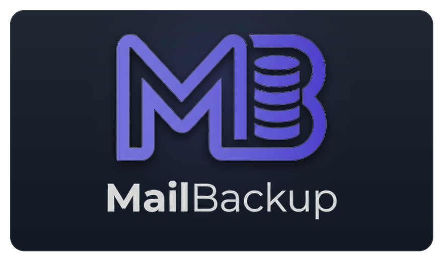

<div align="center">
  

  # MailBackup Studio 📬

  <p><strong>A high-performance, resilient, and non-destructive Email Backup Utility written in Rust.</strong></p>

  <p>
    
    
    
    
  </p>
</div>

Built with a modular architecture featuring:
- **CLI**: Rapid commands with Rich progress bars, interactive setup wizard, FTS5 search, and headless daemon.
- **Embedded Web UI**: Modern dark-mode SPA (HTML5, Vanilla CSS, JS) embedded directly in the binary with zero external runtime dependencies.
- **Desktop GUI**: Native desktop application with system tray integration and notifications via Tauri.
- **Raw Fidelity Storage**: Lossless `.eml` files (RFC 822/5322) preserving headers, attachments, and signatures bit-for-bit.
- **Mbox Export**: On-demand and scheduled export to standard RFC 4155 `.mbox` archives.
- **Strictly Non-Destructive**: Never deletes messages from remote mail servers (`EXAMINE` read-only IMAP mode).
- **SQLite Catalog & FTS5**: Sub-second full-text search across all accounts, subjects, senders, body texts, and attachment names.
- **Configurable Retention**: Automatic local pruning policy (e.g. retain 90 days, 1 year, or keep forever).
- **Security**: OS Keyring integration (macOS Keychain, Windows Credential Manager, Linux Secret Service) with secure local fallback.

---

## Workspace Structure

```
├── Cargo.toml                    # Root workspace configuration
├── crates
│   ├── mailbackup-core           # Core engine: IMAP, SQLite FTS5, Storage, Mbox, Retention, Scheduler
│   ├── mailbackup-cli            # Command-line interface binary (`mailbackup`)
│   ├── mailbackup-server         # REST API server & embedded Web UI (`mailbackup-server`)
│   └── mailbackup-gui            # Native Desktop GUI with System Tray (`mailbackup-gui`)
```

---

## Getting Started

### 1. Build All Binaries

```bash
cargo build --release --workspace
```

### 2. Using the CLI

```bash
# Add an account interactively
cargo run -p mailbackup-cli -- account add

# List configured accounts and storage stats
cargo run -p mailbackup-cli -- account list

# Test IMAP connection
cargo run -p mailbackup-cli -- account test <account_id>

# Run incremental backup
cargo run -p mailbackup-cli -- sync

# Search email archives with instant FTS5 matching
cargo run -p mailbackup-cli -- search "invoice"

# Export a folder or entire account to .mbox
cargo run -p mailbackup-cli -- export-mbox --account <id> --output ./archive.mbox

# Run background scheduled sync daemon
cargo run -p mailbackup-cli -- daemon

# Launch Web Studio
cargo run -p mailbackup-cli -- serve --port 8765
```

### 3. Launching the Web Studio

```bash
cargo run -p mailbackup-server
```

Open your browser at `http://127.0.0.1:8765` to access the full offline email browser, attachment previewer, and account manager.

**API access:** the server listens on `127.0.0.1` only. Every `/api/*` request must carry a random per-process token, which the server embeds in the page it serves, so other websites and DNS-rebinding attacks can't call the API. The token changes whenever the server restarts, so reload open browser tabs after a restart.

Network settings in `config.yaml`:

```yaml
settings:
  web_port: 8765
  # Interface to listen on. Default: 127.0.0.1 (this computer only).
  # Use 0.0.0.0 to reach the Web Studio from other devices or from outside a
  # container. Anyone who can reach the port still needs the token, which they
  # can only get by loading the page, so only do this on networks you trust.
  bind_address: 127.0.0.1
  # Host names (besides IP addresses and localhost) the UI may be opened by,
  # e.g. the domain of a reverse proxy in front of the server. Only list
  # names you control.
  allowed_hosts: []
```

**Upgrading from 0.2.4 or earlier:** older versions listened on all interfaces (`0.0.0.0`) and accepted API calls from anywhere without a token.
- The desktop app, the Windows/macOS/Linux background service and local browser access are unaffected, because they all use `127.0.0.1`.
- If you opened the Web Studio from another device, or run it in a container with a published port, set `bind_address: 0.0.0.0`.
- If you use a reverse proxy with its own domain name, add that name to `allowed_hosts`. The proxy must pass the `X-MailBackup-Token` header through.
- Scripts that called `/api/*` directly now need the token. It's printed nowhere and changes on every start, so the API is meant to be used through the web UI only.

**Export and storage locations (web UI):**
- `.mbox` exports, and moves of the archive folder or database, are limited to your Downloads, Documents and Desktop folders, your home folder, and folders you've chosen with **Browse…**. Browse adds the folder to `settings.approved_dirs` in `config.yaml`; remove entries there to revoke them.
- Exports must end in `.mbox`, can't go into hidden (`.`) folders, and never overwrite symlinks or folders.
- A new archive folder must be new or empty (macOS/Windows metadata files such as `.DS_Store` are ignored). An existing MailBackup archive, for example on an external drive, can be used in place with "Move existing backup files" unticked. A new database path must end in `.db`.
- The CLI (`export-mbox`) is not restricted.

**Account passwords are tied to their server:** each saved password is bound to the account's server, port and username.
- Changing any of these in the web UI requires entering the password again.
- If `config.yaml` is edited to point an account somewhere else, sync refuses to send the old password ("The saved password … belongs to a different server …") until it is re-entered.
- Passwords saved by older versions are bound to the current settings the first time they're used.

**Background service:** Settings → "Run as OS Background Service" installs a service that starts at boot and runs **as your user account**, not as root/SYSTEM:
- Linux: a systemd unit with `User=`.
- macOS: a LaunchDaemon with `UserName`.
- Windows: a boot task with your account and S4U logon. This needs the "Log on as a batch job" right, which domain policy can remove.

Installing and removing still ask for administrator authorization once, because the definitions live in system folders. On Linux this can be up to three prompts.

A service installed by version 0.2.12 or earlier runs with administrator rights. Settings shows "Admin rights: reinstall"; turn the option off and on again to reinstall it as your user.

### 4. Running the Desktop GUI

```bash
cargo run -p mailbackup-gui
```

---

## Running Automated Tests

```bash
cargo test --workspace
```
